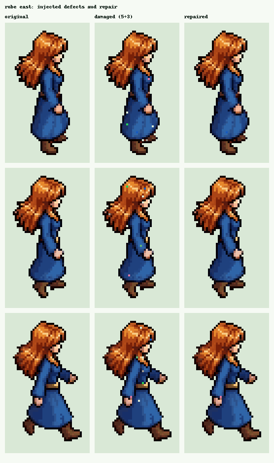
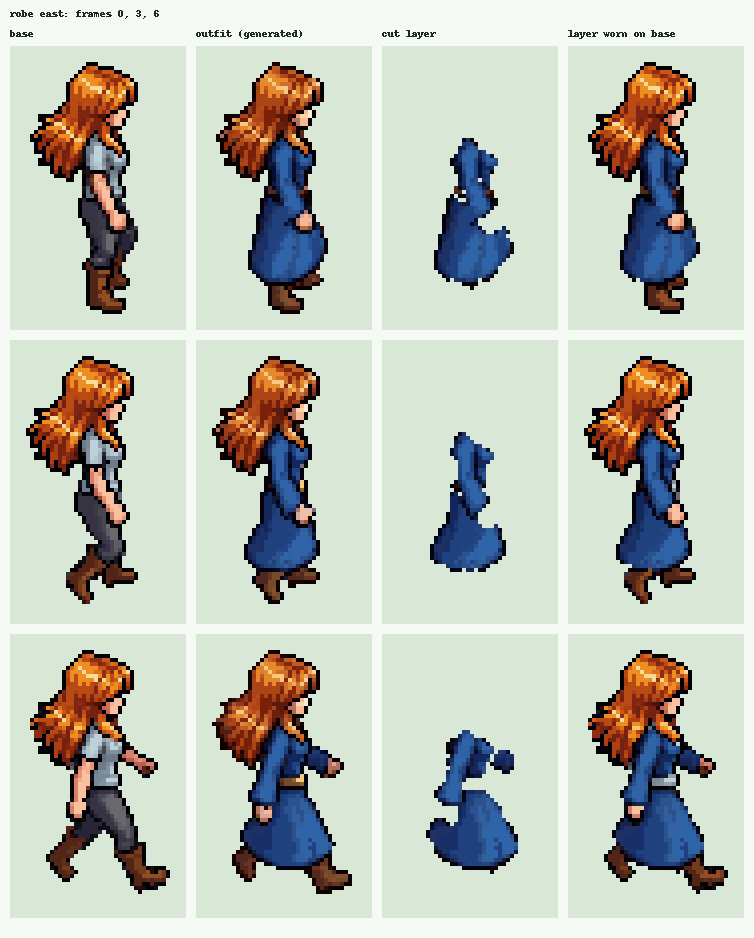
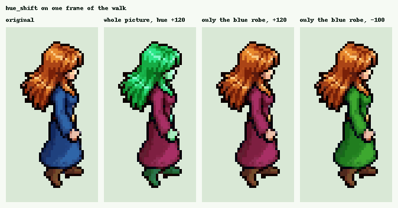
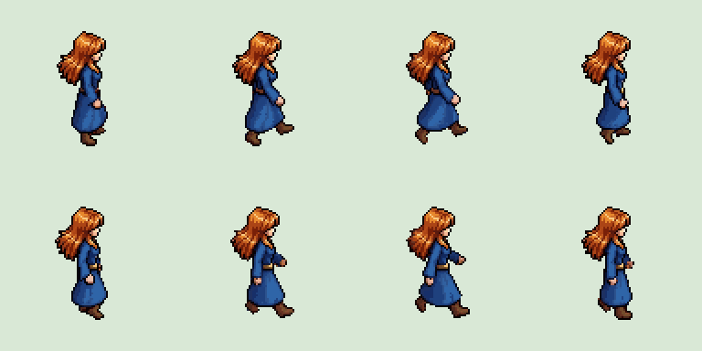
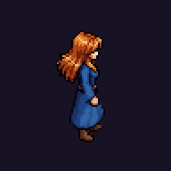
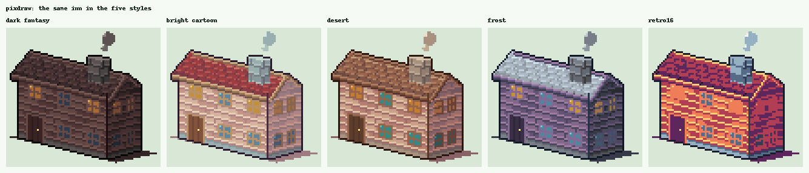

# Gizpix: a free toolbox for fixing and building pixel art

Pixel art is the look of old video games: small pictures made of big, visible square dots. People still draw it by hand, and many people now generate it with AI tools. Generated pixel art looks fine at first glance, but it often has small faults that only show once you put it in a game. Gizpix is a set of tools that finds and fixes those faults and handles a few other chores a pixel-art game needs. It runs on your own computer, costs nothing and never connects to the internet.

## The problem

Picture a game character that walks. The walk is a row of eight pictures, called frames, played one after another. Now picture what can go wrong:

- One frame has a stray dot of the wrong colour, so the character seems to flicker when the walk plays.
- The outline has a hole one dot wide.
- A colour changes slightly from one frame to the next.
- You want the character's robe as a separate piece, so you can put it on other characters. The AI tool only gave you a finished picture of the character wearing it.

Fixing this by hand across hundreds of frames is slow. Gizpix does it in one run and shows you what it changed.



*Left: three frames of a walk. Middle: the same frames with five stray dots and three one-dot holes added on purpose. Right: after Gizpix repaired them.*

## What it does

**Cleaning.** Gizpix finds lone dots of an odd colour and paints them with the colour of their neighbours. It also closes one-dot holes. It works on copies, so your original files stay as they are.

**Cutting clothes into layers.** You give it two pictures of the same pose: the bare character and the character in an outfit. Gizpix compares them and returns the outfit alone, on a see-through background. It then puts that layer back on the bare character so you can check the result. Options remove leftover skin, loose specks, and bits of hair or boots that stuck to the outfit.



*Each row is one frame. From the left: the bare character, the character in the robe, the robe cut out on its own, and the cut-out robe placed back on the bare character.*

**Measuring.** These tools only report and never change a file. They count stray dots, check that lines are clean, and compare colours between frames or walking directions. They also test whether a tile repeats without a visible seam and whether a set of eight walking directions is consistent. Think of them as a checklist before you accept generated art.

**Recolouring.** Gizpix can turn the hue of every frame by the same amount, so a given colour always becomes the same new colour in every frame. It can also make colour variants by group, such as skin or grey tones, or squeeze a picture into a fixed palette.



*One frame, four ways. The second picture turns every colour, hair included. The third and fourth turn only the blue of the robe and leave hair and skin alone.*

**Packing.** It lines frames up so the feet stay on the same row, crops them to a common size, and packs them into one sprite sheet with a data file that a game engine can read. It also makes a preview GIF.



*The eight frames of the walk packed into one sprite sheet. A small data file next to it records where each frame sits.*



*The preview GIF made from the same frames.*

**Drawing buildings from code.** With no reference picture, Gizpix draws buildings from a few settings. There are seven building types, including a cottage, an inn, a keep and a round tower. You choose the number of floors and can add dormers, an L-shaped wing or a lantern. Each building can be drawn in three views (isometric, top-down and side) and in five colour styles. It can also draw scenes with trees, fences, paths and wells, and animate them. The same settings always give the same picture.



*One inn, five styles: dark fantasy, bright cartoon, desert, frost and a 16-colour retro palette.*


*A scene made from a list of buildings, trees and fences, drawn in two styles.*

## Two ways to use it

**In your browser.** Type `gizpix ui` and a page opens with four jobs: Clean and measure, Cut outfit layer, Draw buildings, and Recolour and pack. You pick a folder, press a button and see the pictures before and after, enlarged by whole numbers so the dots stay sharp. Frames are laid out as columns with their numbers underneath. A frame that needs a second look gets a red circle. Nothing is saved until you press Save, and Save always copies into a new folder. Every result also shows the exact command it ran, so you can repeat it later in a script.


*The browser interface after cutting a layer: previews on the left, numbers and the Save button on the right.*

**From the command line.** There are more than thirty small tools behind one command. `gizpix list` shows them all with a one-line description, and `gizpix help` followed by a tool name explains that tool.

## Where your files go

Gizpix runs only on your computer. The web page is served to your own machine and no other computer can reach it. There is no account, no upload and no AI inside the tool, and even the fonts of the interface are included. Your originals are never changed.

## Install

You need Python 3.10 or newer.

```bash
pip install git+https://github.com/lexingel/gizpix.git
gizpix ui
```

## Licence

The code is under AGPL-3.0-or-later. Sprites and sheets you make with Gizpix belong to you, and using the tools in a build script does not change the licence of your game. This text and the screenshots are under CC BY 4.0. A separate commercial licence for closed or hosted use is available on request.
