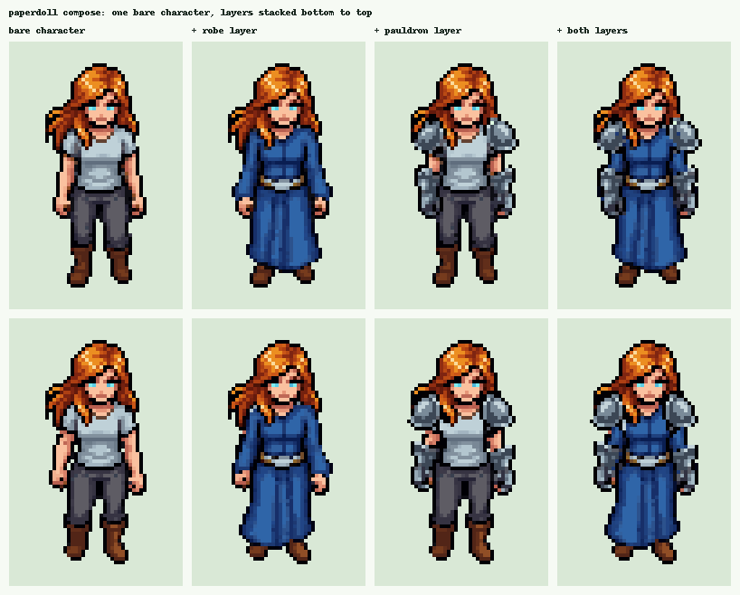
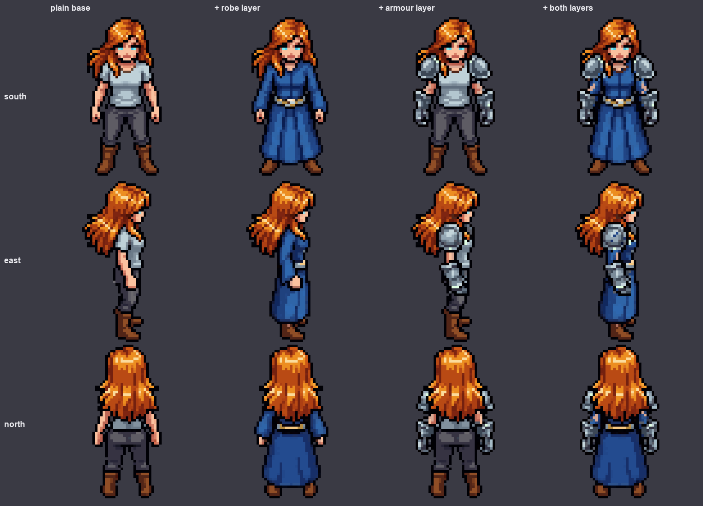
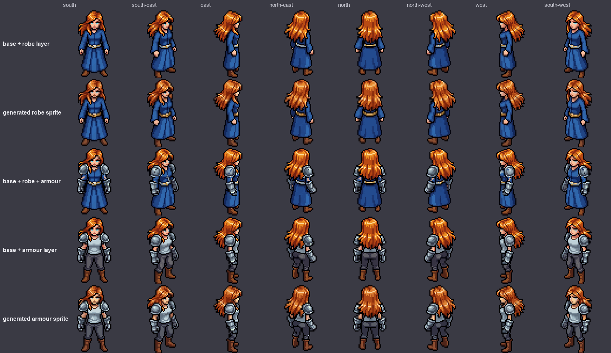
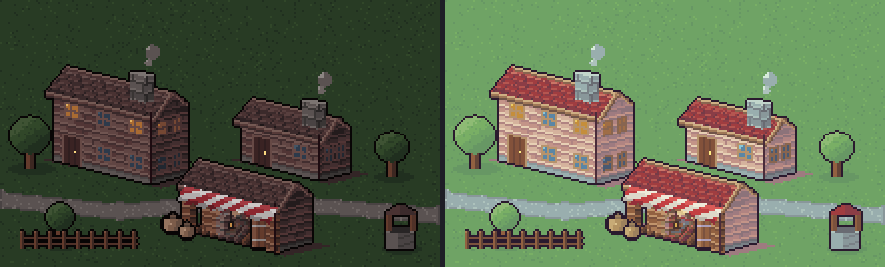
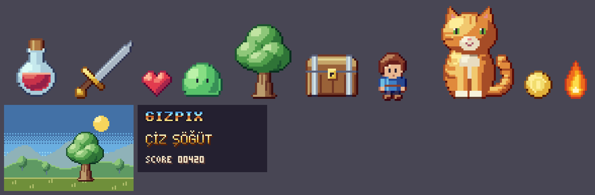
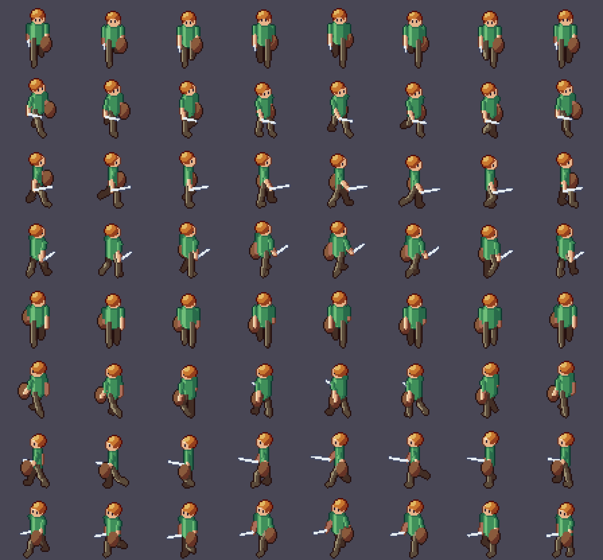
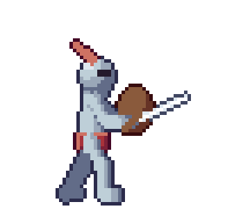
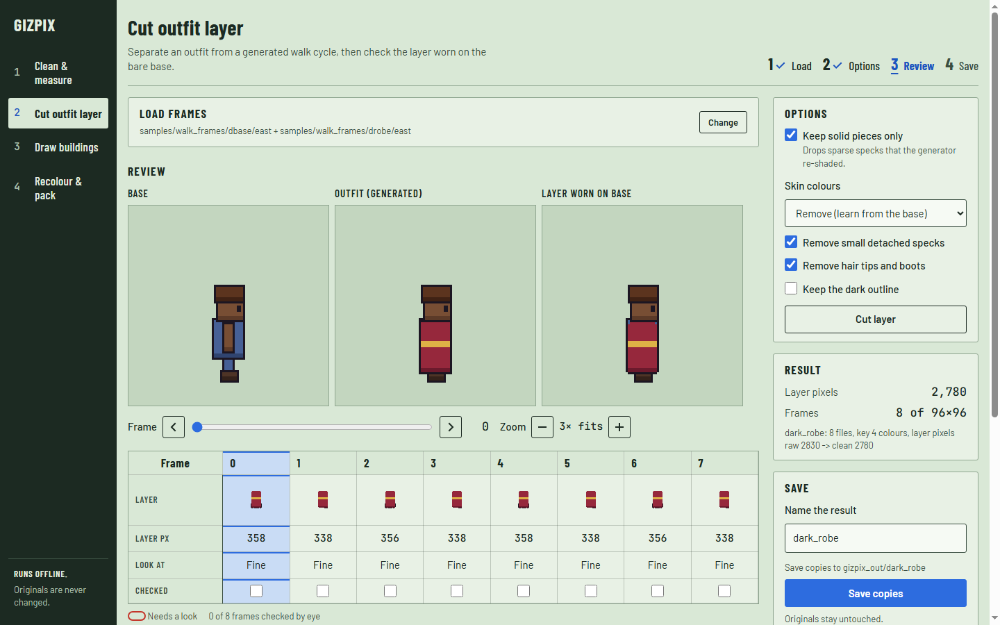

# Gizpix: a free toolbox for fixing and building pixel art

Pixel art is the look of old video games: small pictures made of big, visible square dots. People still draw it by hand, and many people now generate it with AI tools. Generated pixel art looks fine at first glance, but it often has small faults that only show once you put it in a game. Gizpix is a set of tools that finds and fixes those faults and handles a few other chores a pixel-art game needs. It can also draw pixel art itself, from code, with no reference picture. (Game effects such as fire, lightning and portals have their own sister tool, [GizVFX](https://github.com/lexingel/gizvfx).) It runs on your own computer, costs nothing and never connects to the internet.

## The problem

Picture a game character that walks. The walk is a row of eight pictures, called frames, played one after another. Now picture what can go wrong:

- One frame has a stray dot of the wrong colour, so the character seems to flicker when the walk plays.
- The outline has a hole one dot wide.
- A colour changes slightly from one frame to the next.
- You want the character's robe as a separate piece, so you can put it on other characters. The AI tool only gave you a finished picture of the character wearing it.

Fixing this by hand across hundreds of frames is slow. Gizpix does it in one run and shows you what it changed.


*Left: three frames of a walk. Middle: the same frames with five stray dots and three one-dot holes added on purpose. Right: after Gizpix repaired them.*

## What it does

**Cleaning.** Gizpix finds lone dots of an odd colour and paints them with the colour of their neighbours. It also closes one-dot holes. It works on copies, so your original files stay as they are.

**Cutting clothes into layers.** You give it two pictures of the same pose: the bare character and the character in an outfit. Gizpix compares them and returns the outfit alone, on a see-through background. It then puts that layer back on the bare character so you can check the result. Options remove leftover skin, loose specks, and bits of hair or boots that stuck to the outfit.


*Each row is one frame. From the left: the bare character, the character in the robe, the robe cut out on its own, and the cut-out robe placed back on the bare character.*

**Dressing characters in layers.** This way of working is called paperdolling: one bare character, and clothes that lie on top of it like paper cut-outs. Once you have cut your layers, Gizpix can stack any of them on the bare character, from bottom to top, and save the result as an ordinary picture. The layers are copied pixel by pixel from the generator's own picture and never repainted, so the clothes keep the look they were generated with. You can also restrict a cut to one part of the picture, such as the shoulders, set how different a pixel must be from the bare character to count as clothing, and keep only the colours that do not appear on the bare character. When one of these checks fails, the tool says so and stops with an error code, so a script can stop too.



*One bare character and two cut layers, combined in every way. The top row is one frame of the walk, the bottom row another. The layers follow the pose because each frame gets its own cut.*

You cut each outfit once and then mix them, instead of generating every character and outfit combination again. Two further tools try to carry a layer along with a moving character from a single still picture: one follows the character's own motion (it needs the optional OpenCV package) and one builds a simple walk from the parts of a still picture. Both are experimental, and their results are rougher than layers cut from real walking frames.

### What we learned about paperdolls from AI sprites

We ran one small experiment to see whether an AI sprite generator can give you clothing as separate layers: one 64 pixel character seen from 8 directions, five outfits, 78 generations in all (about 0.6 US dollars). It is a first look and not a benchmark. The full note, with every picture, is in [RESEARCH_PAPERDOLL.md](RESEARCH_PAPERDOLL.md). The short version:



*The plain base, the base with a robe layer, with an armour layer and with both. The layers were cut out of the generated sprites with Gizpix and laid back on the base.*

- **One outfit looks the same from all 8 directions.** The generator draws the directions together, and in five outfits none vanished or changed colour between directions.
- **The same description gives a different outfit each time.** Run twice, one description gave two different reds and two different hoods. Generate an outfit once, then keep it.
- **Cutting a layer out works well only on a plain base.** If the base already wears armour or a cape, the cut layer comes out incomplete. On a plain base, a long robe came out complete from every direction, back included.
- **Cut layers leak.** Hair and skin from the base stick to the edges. Keeping only colours that are not in the base's palette removed about 97% of the hair, and about 12 to 23% of the real outfit pixels with it.
- **Two layers stacked on the base fit together**, with a few small gaps.



*The base with the cleaned layers stacked on it, compared with what the generator drew.*

What we did not test: animation (walk and attack frames, the big open question), 128 pixel characters, many characters, and outfits whose colour is close to the base. We also tried the other route, a code rig that cuts one still sprite into parts and poses them. In our one test it was about as good as hand-drawn for idle and small movements, stiff for a hurt flinch, and clearly weaker for a big attack, because a real attack moves the whole body. Treat rigs as a tool for idle poses, flinches, colour and gear variants, and keep big attacks drawn.

**Measuring.** These tools only report and never change a file. They count stray dots, check that lines are clean, and compare colours between frames or walking directions. They also test whether a tile repeats without a visible seam and whether a set of eight walking directions is consistent. Think of them as a checklist before you accept generated art.

**Recolouring.** Gizpix can turn the hue of every frame by the same amount, so a given colour always becomes the same new colour in every frame. It can also make colour variants by group, such as skin or grey tones, or squeeze a picture into a fixed palette.


*One frame, four ways. The second picture turns every colour, hair included. The third and fourth turn only the blue of the robe and leave hair and skin alone.*

**Packing.** It lines frames up so the feet stay on the same row, crops them to a common size, and packs them into one sprite sheet with a data file that a game engine can read. It also makes a preview GIF.


*The eight frames of the walk packed into one sprite sheet. A small data file next to it records where each frame sits.*


*The preview GIF made from the same frames.*

**Drawing buildings from code.** With no reference picture, Gizpix draws buildings from a few settings. There are seven building types, including a cottage, an inn, a keep and a round tower. You choose the number of floors and can add dormers, an L-shaped wing or a lantern. Each building can be drawn in three views (isometric, top-down and side) and in five colour styles. It can also draw scenes with trees, fences, paths and wells, and animate them. The same settings always give the same picture.


*One inn, five styles: dark fantasy, bright cartoon, desert, frost and a 16-colour retro palette.*



*A scene made from a list of buildings, trees and fences, drawn in two styles.*

**Drawing any pixel art from code.** The tool called pixart draws small pictures with no reference picture and no AI: a potion, a sword, a slime, a tree, a chest, a cat, a hero, a coin, a flame, pixel lettering, a small scene. You say where each shape is and what it is made of, and pixart does the pixel craft that is easy to forget: colours that shift hue as they get lighter or darker, one light for the whole picture, a few flat tones for form, a one-dot outline that follows the light, and cast shadows. It then measures its own result (too many colours, near-identical colours, thin parts, stray dots) and writes a review sheet that shows the picture at its real size on three backgrounds, as a silhouette and in grey. There are 14 worked examples and written notes on the craft rules, taken from pixel-art books and tutorials.



*Drawn by code, each from a short script.*

pixart can also build a figure from a skeleton and pose it: 14 key-pose actions (idle, walk, run, slash, thrust, smash, bow, punch, kick, block, hurt, cast and more), and it can turn one pose to any of 8 directions without mirroring anything.



*One figure, eight directions, drawn from the same skeleton. Nothing is mirrored.*



*A sword swing built from key poses.*

**Effects have their own tool now.** Drawing effects (fire, explosions, lightning, ice, healing, portals, hits, rain and many more) grew into a separate tool called GizVFX, at [github.com/lexingel/gizvfx](https://github.com/lexingel/gizvfx). You describe an effect as a short list of layers, it draws it as pixel art or in eight smooth painted styles, checks it, and has a small browser page where you can watch and edit it while you build. Gizpix no longer contains the effects.

## Two ways to use it

**In your browser.** Type `gizpix ui` and a page opens with four jobs: Clean and measure, Cut outfit layer, Draw buildings, and Recolour and pack. You pick a folder, press a button and see the pictures before and after, enlarged by whole numbers so the dots stay sharp. Frames are laid out as columns with their numbers underneath. A frame that needs a second look gets a red circle. Nothing is saved until you press Save, and Save always copies into a new folder. Every result also shows the exact command it ran, so you can repeat it later in a script.



*The browser interface after cutting a layer: previews on the left, numbers and the Save button on the right.*

**From the command line.** There are more than thirty small tools behind one command, in groups: check, clean, colour, draw, layers, prep, rig and sheets. `gizpix list` shows them all with a one-line description, and `gizpix help` followed by a tool name explains that tool. The browser page covers cleaning, layer cutting, buildings and recolouring and packing; drawing with pixart is done from the command line or from a short Python script.

## Where your files go

Gizpix runs only on your computer. The web page is served to your own machine and no other computer can reach it. There is no account, no upload and no AI inside the tool, and even the fonts of the interface are included. Your originals are never changed.

## Install

You need Python 3.10 or newer.

```bash
pip install git+https://github.com/lexingel/gizpix.git
gizpix ui
```

## Licence

The code is under AGPL-3.0-or-later. Sprites and sheets you make with Gizpix belong to you, and using the tools in a build script does not change the licence of your game. This text and the screenshots are under CC BY 4.0. A separate commercial licence for closed or hosted use is available on request.
