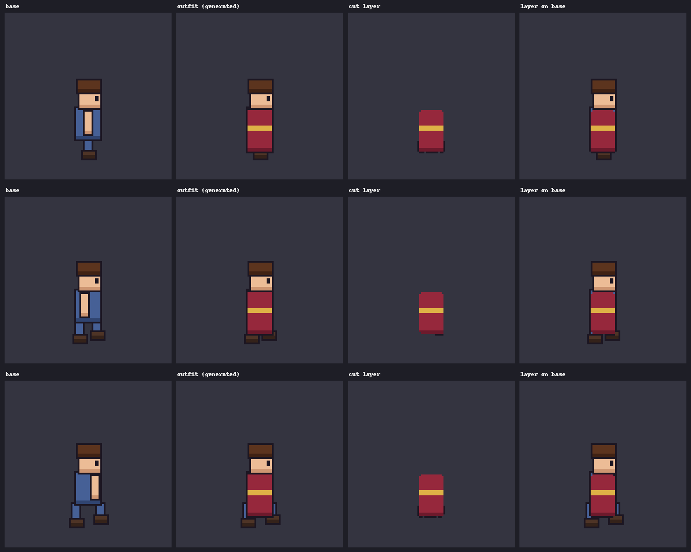
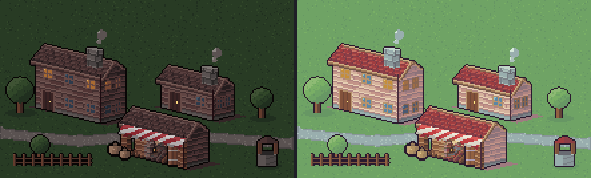
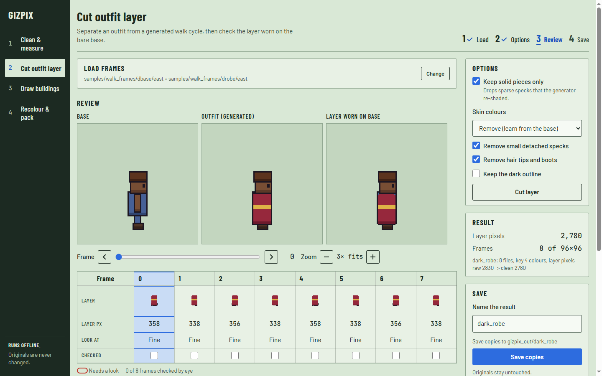
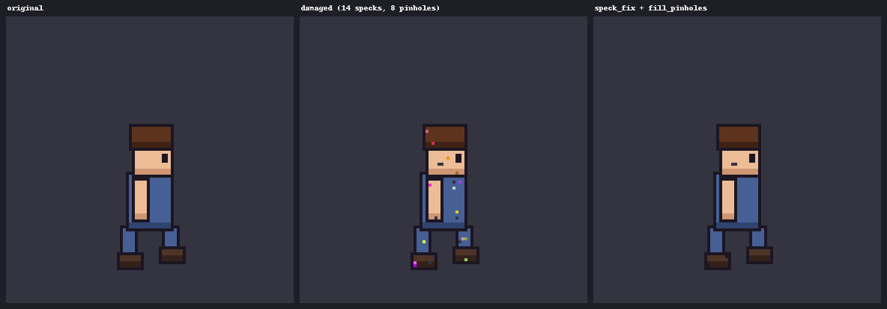

# Gizpix

*New to pixel art? Read the plain-language overview: [ABOUT.md](ABOUT.md).*

A local, free, offline toolkit for pixel-art sprites. It cleans animation frames, cuts outfit layers out of generated sprites, measures quality, recolours, aligns and packs frames, and draws pixel-art buildings and villages from code. Nothing calls a network or an AI service; every tool reads and writes plain PNG/GIF/JSON files, so you can run it in a build script or let a coding agent drive it.



*`pix_layer cut` on the bundled sample frames: the outfit is separated from a generated walk cycle and worn back on the bare base.*



*`pixdraw scene` renders a looping village from a 15-line JSON file, here in two bundled styles.*

## Prefer a window to a terminal?

```bash
python gizpix.py ui            # opens the interface in your browser (localhost only)
```

The interface covers four jobs: **Clean & measure**, **Cut outfit layer**, **Draw buildings**, **Recolour & pack**. Frames sit side by side as columns on an exposure sheet with their numbers; every preview is shown at a whole-number zoom, nearest-neighbour; every result shows the exact command it ran. Nothing is written until you press Save, and Save always makes a new folder, so your originals are never changed. It runs on your machine only (no network, no account).



*The "Cut outfit layer" job on the bundled dark-skin sample. Previews are whole-number zoom, the sheet shows each frame as a column (a frame is circled in red when it needs a look), and Save is in view.*

## Who it is for

Indie game developers, and their coding agents, who generate or hand-draw sprites and then need the dull, exact parts done reliably: fix specks and pinholes, keep frames on one palette and one ground line, split an outfit into a layer, check a set of directions for drift, build placeholder or final architecture without a reference image.

## What it does not do

- It does **not generate art**. It never calls an image or animation generator. Use whichever generator you like, then clean up with Gizpix.
- It is **not an editor**. Everything is a command-line step on files.
- The layer-cutting tools were developed and measured on **one character from one skeleton-driven generator** (AI-generated frames that are not bundled; the bundled samples are code-drawn and clean). Other characters and generators are untested; see [Known limits](#known-limits).
- Tested on Windows only so far; the code is plain Python and should run elsewhere.

## Install

Not on PyPI. Install straight from GitHub, or from a clone:

```bash
pip install git+https://github.com/lexingel/gizpix.git     # gives you the `gizpix` command
gizpix doctor                                               # checks packages, every tool's self-test
gizpix ui                                                   # the local web interface
```

From a clone you can also run it without installing:

```bash
git clone https://github.com/lexingel/gizpix.git
cd gizpix
pip install -r requirements.txt        # numpy, Pillow, scipy (+ opencv-python, only used by warp_layer)
python gizpix.py doctor
```

Python 3.10 or newer. Wherever this README writes `python gizpix.py`, the installed command is just `gizpix`. After `pip install`, `gizpix path` prints where the tools and `samples/walk_frames` live.

## Five-minute tour

```bash
python gizpix.py list                                   # every tool, grouped, one line each
python gizpix.py find outline                           # which tools mention a word
python gizpix.py help pix_layer                         # a tool's own documentation (nothing is run)

# measure: sprite quality numbers (specks, thick lines, stair breaks, palette)
python gizpix.py pixel_lint samples/walk_frames/base/east/0.png

# layer: cut the robe out of 8 walk frames (base folder, outfit folder, same file names)
python gizpix.py pix_layer cut samples/walk_frames/base/east samples/walk_frames/robe/east layers \
    --name robe --solid --drop-skin auto --bits --drop-parts

# draw: a building and a whole village, no reference image
python gizpix.py pixdraw build "type=inn,proj=iso,floors=3" --style dark_fantasy --out out --frames 8 --scale 3
python gizpix.py pixdraw scene pixdraw/examples/village.json --style frost --out out --frames 8
```

Repair a damaged frame (colour specks and one-pixel holes), with the pictures `images/repair.png` shows:

```bash
python gizpix.py speck_fix damaged.png step1.png
python gizpix.py fill_pinholes step1.png --out fixed/
```



## The tools

Run `python gizpix.py list` for the live list; `python gizpix.py help TOOL` for details.

| Group | Tools |
|---|---|
| **layers** | `pix_layer` cut an outfit layer from base-vs-outfit sprites or walk frames; `paperdoll` difference-based extract/compose |
| **check** (measure only) | `pixel_lint` quality numbers; `palette_diff` colour drift against a reference; `tile_check` seams; `check_8dir` direction-set QA; `qa` batch checks; `apply_pixel_fixes` auditable single-pixel edit list |
| **clean** | `speck_fix`, `fill_pinholes`, `painterly_clean`, `scrub`, `colormatch`, `ground_snap`, `palette_lock`, `clean_frames`; `despeckle` and `repair_outline` only for noisy generator output |
| **color** | `hue_shift` turn the hue (same colour always gives the same result across frames); `recolor_groups` variants by colour group; `apply_palette` snap to a fixed palette |
| **sheets** | `align_frames` feet/column alignment; `trim_frames` shared crop; `make_sheet` sprite sheet + JSON; `preview_gif`; `contact_sheet`; `pad_sprite` |
| **prep** | `pix_snap` turn an upscaled or off-grid image back into real pixels |
| **rig** | `rig_walk2`, `warp_layer`, `xform`: code-driven walks and moving a layer with the base |
| **ui** | `python gizpix.py ui`: the local web interface for the four jobs above (not a separate tool; it runs the same commands) |
| **draw** | `pixdraw`: buildings (house, cottage, inn, tower, round tower, keep, stall), three views (`iso`, `top`, `side`), five JSON styles, scenes with trees, fences, paths; `extract-style` makes a starting style from your own sprites |

Every tool answers `-h`, prints one-line errors on bad input and exits 2 for usage problems.

### Which tools change your files

Most tools write somewhere new. These edit **in place unless you pass `--out`** (they print a note on stderr when they do): `fill_pinholes`, `colormatch` (keeps originals in `orig/`), `despeckle`, `ground_snap`, `painterly_clean`, `apply_palette`. `apply_pixel_fixes` always edits in place. Tools that write into `--out` refuse two inputs with the same file name. When a tool has `--out`, use it.

## Words you will meet

- **base / outfit**: the bare character, and the same character wearing something, drawn in the same pose and canvas size.
- **layer**: only the outfit's pixels, transparent elsewhere, so it can be drawn over any base.
- **key colours**: colours that appear in the outfit image but not in the base; the cut keeps those.
- **skin drop** (`--drop-skin`): removes skin-coloured pixels the generator re-shaded into the layer. `auto` learns the skin colour from the base.
- **bits** (`--bits`) and **parts** (`--drop-parts`): remove small detached body-like specks, and hair tips and boot slivers that hang on the outfit.
- **leak**: a body pixel that ends up in the layer by mistake.
- **speck / pinhole**: a lone wrong-coloured pixel / a missing pixel inside a sprite.
- **ramp**: a light-to-dark series of colours for one material; the pixdraw styles are made of ramps.
- **golden hashes**: stored fingerprints of fixed renders; a changed render fails the test on purpose.

## Known limits

- Dark outfit over dark skin: with AI-generated frames the **east** layer of a dark-skin pair had holes (the outfit and the body barely differ there); colour rules cannot add missing pixels. A contrasting outfit colour or a base without hair and boots avoids it.
- `--bits` and `--drop-parts` can remove a few real pixels (a belt buckle, a forearm edge): look at the result at 3×.
- `despeckle` and `repair_outline` can damage clean sprites; use them on frames that have the defect.
- `top`-view buildings with an L-wing read less clearly than `iso`.
- `extract-style` is a starting point to edit, not a copy of your sprites.
- The numbers behind each claim, with pictures of the tools on real generated frames (including the failure case), are in [MEASUREMENTS.md](MEASUREMENTS.md).

## For AI coding agents

[HANDOUT.md](HANDOUT.md) is written for agents: what to use when, two tested recipes, which tools overwrite input, and rules. Point an agent at it and at `python gizpix.py doctor`.

## Tests

```bash
python gizpix.py doctor        # packages + every tool's -h + defect-injection tests on the bundled samples (about 2 minutes)
python selftest_all.py           # all self-tests, the chain test, pixdraw selftest + golden hashes
python -m pytest                 # pixdraw tests (configured in pyproject.toml)
python experiments/demos/make_demos.py   # regenerate the pictures in images/
```

`pixdraw` golden hashes depend on the Pillow version; with another version they print SKIPPED (run `gizpix.py pixdraw golden --update` to make local ones).

## Sample data

`samples/walk_frames/` has a small 96×96 character walking east and south (8 frames each): bare (`base`), in a robe (`robe`), in pauldrons (`pauld`), and a dark-skin pair (`dbase`, `drobe`). They are drawn from code by `samples/make_samples.py` and use the same licence as Gizpix, so you can try the layer tools without an account or any generator.

## Licence and provenance

- **Code:** AGPL-3.0-or-later, see [LICENSE](LICENSE).
- **Your output is yours.** Sprites, sheets, GIFs and buildings you make with Gizpix belong to you, and running the tools from a build script or a pipeline does not change the licence of your game. The AGPL only reaches you if you modify Gizpix and let other people use the modified version over a network, or if you ship Gizpix's code inside your own product.
- **Closed, embedded or hosted use:** a separate commercial licence is available. Open an issue titled "Commercial licence" in this repository.
- **Documentation and pictures:** CC BY 4.0 (credit "Gizpix" and link back); the pictures in `images/evidence/` and `images/about/` are CC0. See [LICENSE-DOCS](LICENSE-DOCS).
- **Name:** "Gizpix" is the name of this project. A fork should use another name.
- Third-party data and licences: [NOTICE.md](NOTICE.md). Contributing: [CONTRIBUTING.md](CONTRIBUTING.md).
