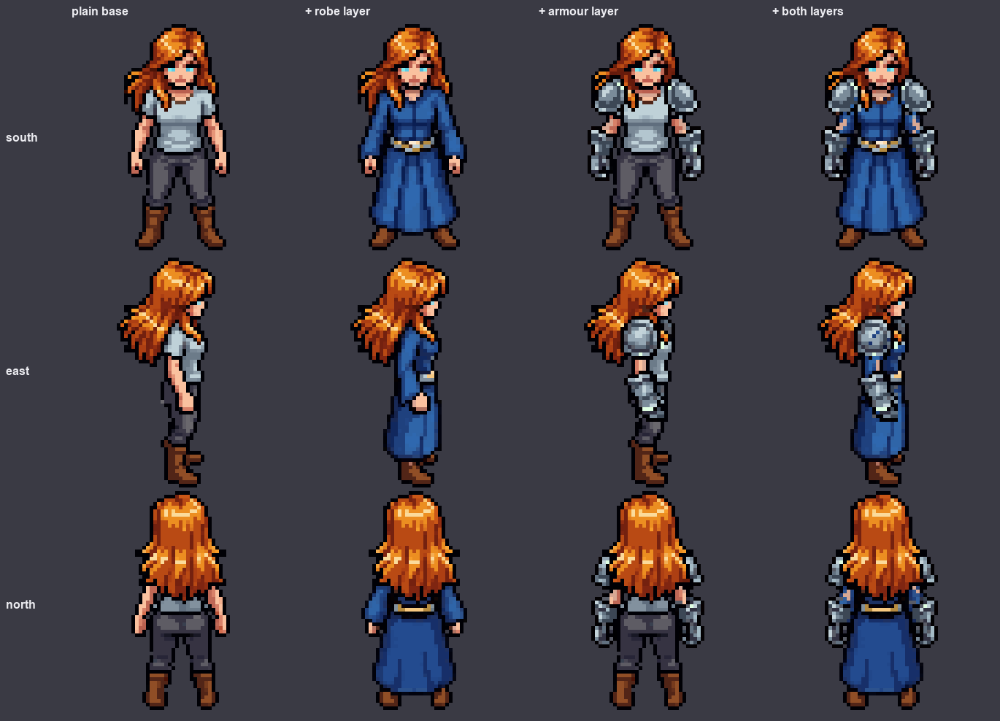
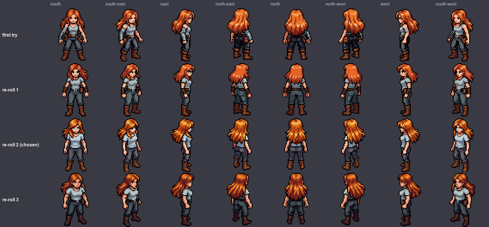
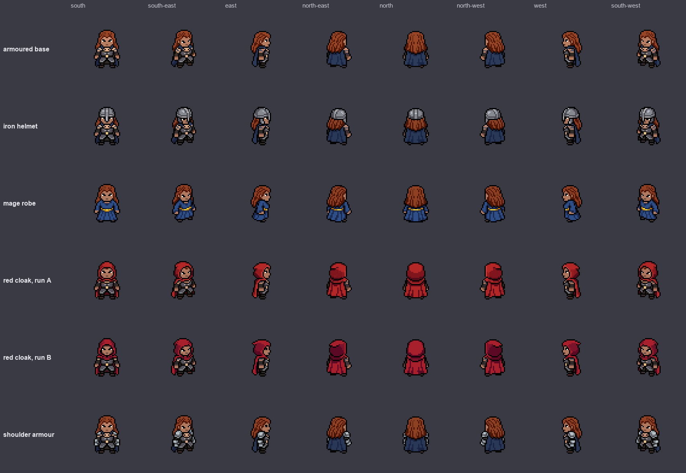
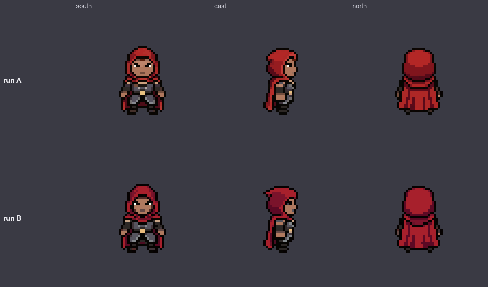
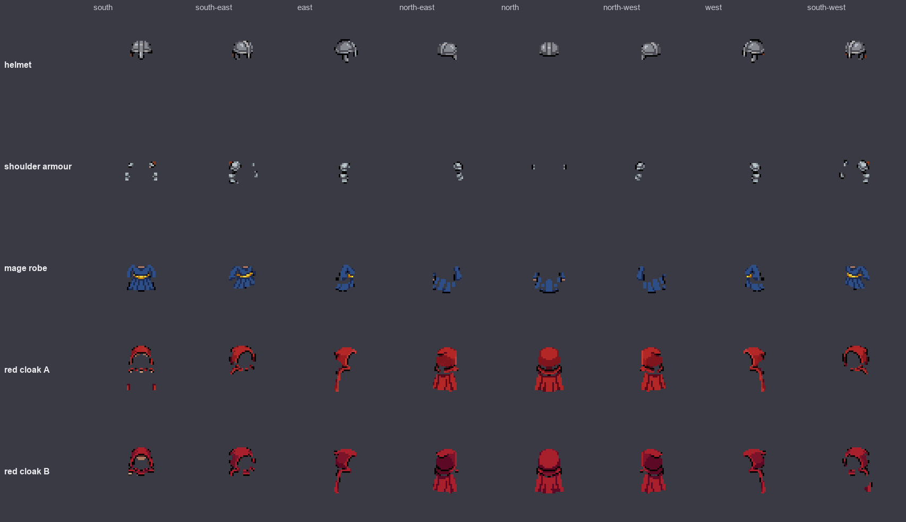
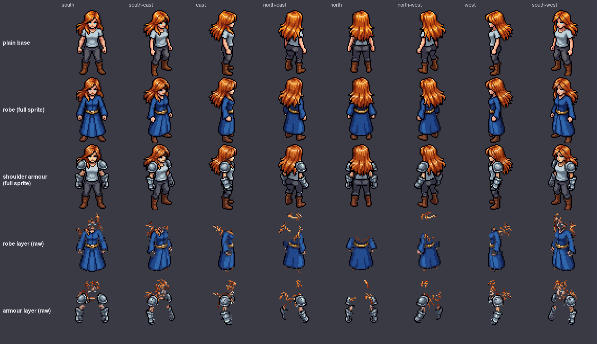
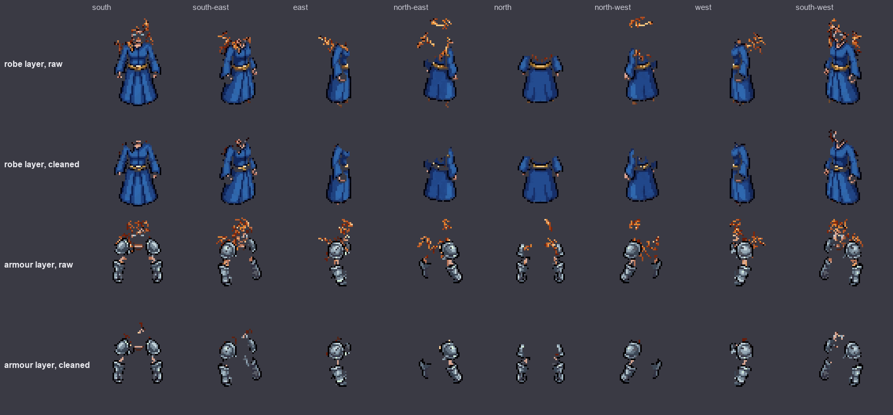
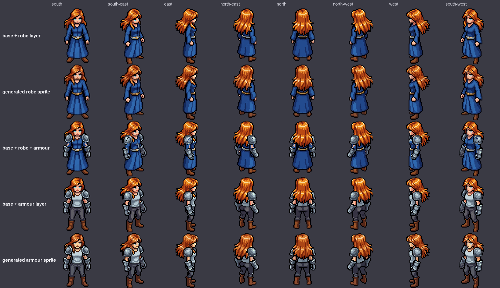

# Can AI keep clothing layers consistent? A small test with PixelLab

A research note on a 64×64 pixel character with 8 directions. Written 2026-11-07. Everything here comes from one short experiment: one character, five outfits, 78 generations in total (about $0.59). It is a first look, not a benchmark.

## The short version

We wanted to know whether an AI sprite generator can give us **clothing as separate layers** (helmet, robe, armour pieces) that fit one character in all 8 directions, so a game can swap and stack them like a paper doll.

What we found:

1. **Consistency across directions is good.** When the generator draws a new outfit, it draws all 8 directions together, and they match. In 5 outfits, the outfit never vanished from one direction and never changed colour between directions.
2. **Consistency between runs is not.** The same description run twice gave two different outfits (different red, different hood shape). A tool built on this must generate an outfit once and keep it.
3. **Cutting an outfit out as a layer only works well on a plain base.** If the base character already wears armour or a cape, the cut-out layers come out incomplete. On a plain base, a long robe was recovered completely in all 8 directions.
4. **Cut-out layers leak.** Bits of the base character (hair, skin) stick to the edges. A simple colour rule removed about 97% of the hair leakage, but it also removed some real outfit pixels (12-23%).
5. **Two layers stacked on the base fit together.** The robe plus the shoulder armour looked right in all directions, with a few small gaps.
6. **Not tested:** animation (walk, attack), 128 px characters, many characters, and outfits whose colour is close to the base.

## What we wanted to find out

A paper doll system needs three things at once:
- each piece of clothing is its own transparent layer,
- it looks like the same piece in all 8 directions,
- it fits the body and can be stacked with other pieces.

AI generators redraw the whole character when you ask for a change, so they do not give you layers directly. The idea we tested: generate the character wearing the outfit, subtract the plain character, and keep the difference as the layer.

## How we did it

1. **Make a plain base.** A 64×64 character with long orange hair, a plain grey t-shirt, grey trousers and brown boots. No belt, pouch, armour, cape or wrist wraps, because anything the base wears ends up inside the outfit layers.
2. **Ask for a new look.** PixelLab's "new state of this character" job: base character + a sentence describing the outfit → the same character in the outfit, all 8 directions at once. 10 generations at 64 px.
3. **Download the 8 directions** and look at them side by side at 3× size.
4. **Subtract the base** from the outfit sprite, per direction. What is different is the layer.
5. **Clean the layer.** Remove tiny stray pieces, and remove colours that belong to the base and not to the outfit.
6. **Stack the layers** on the base again and compare with the generated sprite.

We ran this first on a character that was already wearing armour and a blue cape (five outfits: iron helmet, mage robe, red hooded cloak twice, shoulder armour). Then we made a plain base and repeated the robe and the shoulder armour on it.

## Findings

### 1. The base character matters, even before the outfit
The first "plain" base still had a belt, a pouch and wrist wraps. Re-rolling (2 generations each, no way to fix the random seed) gave three more tries. We chose the one with a plain t-shirt, plain trousers, and no belt or pouch. A base with extra clothing makes every outfit layer dirtier.

### 2. Each outfit is consistent across the 8 directions
Five outfits on the first (armoured) base. In each row the same outfit appears in all 8 directions with the same colours.

| Outfit | Pixels changed against the base (per direction) |
|---|---|
| Iron helmet | 101-142 |
| Shoulder armour + gauntlets | 30-104 |
| Mage robe | 150-287 |
| Red hooded cloak | 197-409 |

### 3. The same description, run twice, gives two different outfits
Both rows below used exactly the same sentence. The second run is a darker crimson and the hood has a different shape. About 25-35% of the outfit's pixels differ between the runs.

What this means for a tool: you cannot count on getting "the same outfit again". Generate once, review, store.

### 4. Cutting layers out of an armoured base: partly works
On the first base, the helmet and the cloak could be cut out reasonably. The shoulder armour is tiny and broken up from behind (hair and cape cover it). The robe's lower half is missing from the back, because the blue cape already on the base looks too much like the robe, so the subtraction treats it as "unchanged".

### 5. On a plain base the layers are much better
With the plain base, the robe came out complete in all 8 directions, including the back. The armour layer shows the shoulder plates and gauntlets in every direction.

| | First (armoured) base | Plain base |
|---|---|---|
| Robe | Skirt missing from the back directions | Complete in all 8 directions |
| Shoulder armour | Only specks from behind | Clear in all 8 directions (285-449 pixels) |

### 6. Cleaning removes most of the leakage, at a cost
The raw layers carry orange hair crumbs from the base. We kept only colours that are not in the base's colour palette, plus the dark outline. Hair leakage fell from 508 to 12 pixels (robe) and from 643 to 28 pixels (armour). The price: 12-23% of the layer's pixels went too, mostly shading and neck edges. A few dark red specks remain near the shoulders.

This rule only works because the outfit colours (blue, steel) differ from the base colours (orange, grey, brown). An outfit that is the same colour as the base would need a different rule.

### 7. Stacking works
We laid the cleaned layers back on the base and compared with the generated sprite. The robe layer on the base looks like the generated robe sprite, and no base pixels stick out from under it. The robe plus the armour looks right, with a few small gaps where the armour covers the blue sleeves.

## What we did not test

- **Animation.** We only tested standing poses. Keeping layers consistent over walk and attack frames is the big open question.
- **128 px.** Everything was 64 px. Earlier, at 128 px, this generator drifted toward a realistic adult style.
- **One character, five outfits.** Too few to give success rates.
- **Characters that already wear clothes.** We made our own plain base. Getting a plain base out of a finished, dressed character is untested.
- **Outfits close to the base colour** (grey armour on a grey shirt).
- **Hair as its own layer.** Hair stayed in the base and leaked into the layers.
- **Cost per customer.** One outfit is 10 generations at 64 px (about $0.07-0.08), before retries.

## If you want to repeat it

- Tools used (PixelLab MCP): create a character (v3 mode, 64 px, low top-down view, 2 generations), then "create character state" for each outfit (10 generations at 64 px).
- Plain base description: "warrior woman with long orange hair wearing a plain light grey short-sleeve t-shirt, plain dark grey trousers and plain brown boots, bare arms and bare hands, no belt, no pouch, no armor, no cape, no arm wraps, no accessories".
- Outfit descriptions (each ends with "keep the face, hair colour and pose"):
  - "wearing a long blue mage robe with a gold belt instead of the t-shirt and trousers"
  - "wearing steel plate pauldrons on both shoulders and steel gauntlets"
  - "wearing a red hooded cloak over the armor, hood up, cloak reaching the knees" (run twice)
  - "wearing a plain iron helmet with a nose guard"
- Layer cut-out: subtract the base from the outfit sprite pixel by pixel (we used a small script of ours), drop detached pieces smaller than 5% of the biggest piece.
- Cleaning rule: keep layer pixels whose colour is not in the base's palette, plus the dark outline (RGB sum under 150); drop the orange hair tones.
- Check every direction by eye at 3×. Numbers alone did not catch the missing robe skirt.
