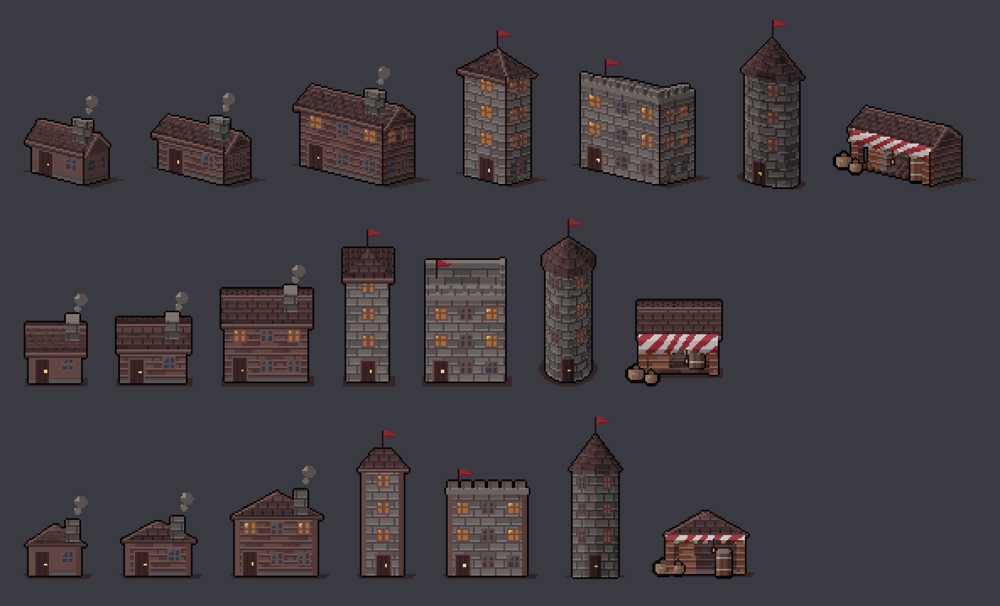

# pixdraw - a pixel-art building drawer you can run from code

Draws pixel-art buildings from a handful of parameters. **No reference image, no AI generation, no game assets**: every face is projected from 3-D, textured by a
material function, coloured by a style file, cleaned by the same tools as the rest of Gizpix. Pure Python (numpy + PIL).



## Quick start

```bash
python -m pixdraw build "type=inn,proj=iso,floors=3" --style dark_fantasy --out out --frames 8 --scale 3 --ms 120
python -m pixdraw gallery gallery.png --style desert
python -m pixdraw styles        # also: materials, presets, extract-style, selftest;  -h on any command
# a mistake in the spec is a one-line error naming the key, e.g.  pixdraw: unknown roof 'x'; choose gable, hip, flat or cone (cone is for round buildings)
```
```python
from pixdraw import render
frames = render({"type": "stall", "proj": "iso"}, "bright_cartoon", frames=8)   # list of PIL RGBA images, same size, loops
```
`build` writes `NAME.png`, and for animations `NAME.gif`, `NAME_sheet.png` and `NAME_sheet.json` (TexturePacker "hash" frames plus an Aseprite-style `frameTags` entry, so Godot, Phaser and Unity importers read it).

## What a building spec can say

| key | values |
|---|---|
| `type` | `house` `cottage` `inn` `tower` `round_tower` `keep` `stall` (presets; every other key overrides them) |
| `proj` | `iso` (2:1-ish oblique), `top` (3/4 RPG view), `side` (platformer, gable end towards you) |
| `W`, `D`, `floors`, `fh` | footprint and storeys, in world units (1 unit = 1 pixel along the width axis; W, D >= 12, fh >= 14; a hip roof needs W >= D). The canvas follows the projected size, nothing is clipped |
| `roof`, `pitch`, `overhang` | `gable` / `hip` / `flat` (flat gets a parapet, `battlements` adds merlons) / `cone` (round buildings only) |
| `dormers`, `wing`, `round` | `dormers`: 0-4 small dormer windows on the front slope of a gable roof; `wing`: `true` or `{"w": 20, "l": 16}` = an L-shaped plan with a gabled wing at the left end of the front (the door moves to the wing); `round`: a round building, `W` is the diameter, roof `cone` or `flat` (try `type=round_tower`). Dormers and wing: gable roof, `iso` or `top` only |
| `wall`, `roof_mat` | any material name: `planks stone brick plaster thatch shingles tiles plain` (or your own, see below) |
| switches | `chimney smoke lit awning open_front lantern flag door ground plinth` (`ground` = footprint shadow, `plinth` = stone course at the foot) |
| `side_gable` | `roof` (default: the gable end is shingled like a roof) or `wall` (wall-coloured gable with rake slabs) |
| openings | `windows` (per storey), `win_w`, `win_h`, `door_w`, `door_h`, `chimney_fx`, `chimney_fy`, `chimney_w` - defaults follow `fh` and `W` |
| `props` | `[{"kind": "crate"/"barrel"/"sack", "x": .. or "fx": fraction of W, "y": .. or "fy": fraction of D, "z": .., "w": ..}]` |

Animated: lantern flicker and sway, awning ripple, chimney smoke, flag. All loop exactly (phase 1.0 equals phase 0.0).

## Scenes: several buildings in one picture

```bash
python -m pixdraw scene pixdraw/examples/village.json --style bright_cartoon --frames 8 --scale 4
```
```python
from pixdraw import compose
frames = compose([{"path": [[0, 90], [160, 96]], "w": 9}, {"building": {"type": "inn"}, "x": 70, "y": 80}, {"tree": 18, "x": 130, "y": 84}], "dark_fantasy", size=(180, 120), frames=8)
```
Items: `building` (any spec above), `tree` (size, `kind` `round` or `pine`), `bush`, `well`, `fence` (`[x0, x1]` + `y`; or `"axis": "y"` with `[y0, y1]` + `x` for one running away from the viewer), `path` (`[[x, y], ...]` + `w`). `x, y` is the foot point; items are drawn in y order. Grass comes from the style's `grass` ramp,
or is derived from its wall ramp. Buildings animate, the rest is still. Everything is on the ground plane (no hills, water or rooms).

## Styles are data

A style is a JSON file (see `styles/*.json`): a colour **ramp** per role (wall, roof, stone, trim, glass, glow, door, awning_a, awning_b, prop, wood, cloth, crate, interior; missing roles are derived), an outline
colour, and an optional fixed palette every pixel is snapped to. A ramp is either an explicit list of hex colours (dark to light) or generated
`{"h": [shadow_hue, light_hue], "s": .., "v": [lo, hi]}` - the hue drifts from shadows to highlights, which is most of why the result does not look flat.

Bundled: `dark_fantasy`, `bright_cartoon`, `desert`, `frost`, `retro16` (Sweetie 16 palette). Use your own: `render(spec, "my_style.json")`.

**Style from your own sprites:** `python -m pixdraw extract-style a.png b.png --out my_style.json` takes the most used colours as the palette, groups the coloured ones by hue (the group that sits highest in the sprites = roof, the heaviest of the others = wall, then trim; greys = stone) and gives each ramp its group's hue, saturation and value spread. It is a starting point to edit, not a copy of the sprites.

## Add a material

```python
import pixdraw, math
def corrugated(u, v): return 3 if math.floor(u) % 4 == 0 else (1 if math.floor(u) % 4 == 3 else 2)   # tone class: 0 seam, 1 low, 2 high, 3 highlight
pixdraw.register_material("corrugated", corrugated)
pixdraw.render({"type": "house", "roof_mat": "corrugated"}, "desert")
```
`register_material(name, fn, ramp="wall")`: `ramp` is the style role whose colours the material uses. A material may also return a ready RGB tuple, or `None` for an empty pixel.

## How it works (so you can change it)

- `core.py` - canvas, `View` (projection = three screen vectors for x, y, z), `face3()` (a textured flat polygon in the world), `box()`, `beam()`, silhouette `tidy()` + outline.
- `materials.py` - `(u, v) -> tone class`. `styles.py` - ramps and style loading. `parts.py` - doors, windows, awnings, props, lantern light, smoke, flag.
- `templates.py` - presets, the iso/top builder (`_ridge`) and the side builder (`_side`), `render()` (crops all frames to one shared box).
- Light comes from the left: front faces step one tone lighter, gable ends one darker, roofs follow a gradient; shadows under the eaves and at the foot are one more step.
  Light and shadow are **solid steps along the style's own colours** (no dithering).

## Limits (read before relying on it)

- Buildings, simple props and ground only (trees, fences, wells, paths are basic). It does not draw characters or organic things.
- One roof shape per building (gable, hip, flat or cone). The L-plan has one wing, on the left, with the same pitch as the main roof; no T-plans or two wings, no stairs. Dormers are small shed-roofed boxes, and one is dropped where it would sit on the chimney. Round buildings have no chimney, and a flat round roof has a parapet ring but no merlons.
- Quality target: clean, consistent, readable game sprites and placeholders - not hand-painted art. Doors, windows and props are simple.
- `top` and `side` are closer to `iso` now (shingled gable end and corner pilasters in `side`, 35% flatter roofs in `top`, footprint shadow and stone plinth everywhere) but still simpler: no interior visible from above, no roof windows, doors and windows are the same in every view. The `extract-style` result is still rough: it groups colours by hue only, so a red roof and a pink wall of the same hue end up in one group.
- Hue drift of a generated ramp is capped at 0.25 of the colour wheel (more breaks palette snapping).
- Text and signs are not drawn.

## Tests

`python -m pixdraw selftest` (every preset x projection x style, bad specs, clipping, loops, palette, no game names, golden hashes) and `python -m pixdraw golden` (SHA-256 of 50 fixed renders; `--update` after an intended change). With pytest: `pytest pixdraw/test_pixdraw.py` (on this machine a protobuf plugin breaks pytest start-up: use `PYTEST_DISABLE_PLUGIN_AUTOLOAD=1`).

## Licence and provenance

All code and the bundled styles are original to this project. The only third-party data is the Sweetie 16 palette (GrafxKid, CC0) in `styles/retro16.json`.
See `NOTICE.md`. The package contains no game assets; `python -m pixdraw selftest` checks that no game-specific names appear in it.
